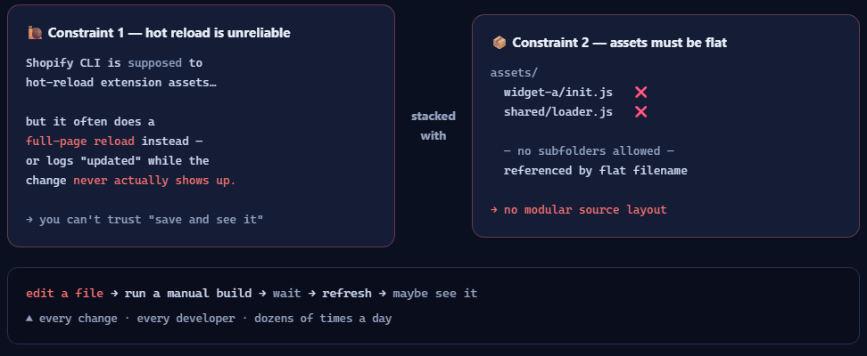
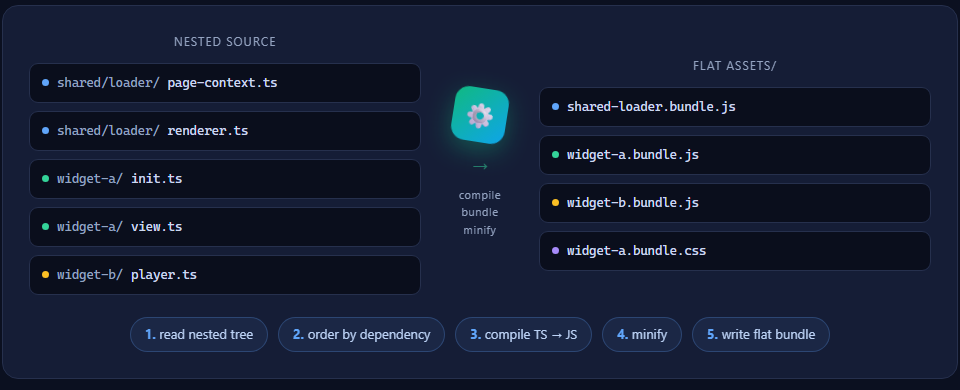
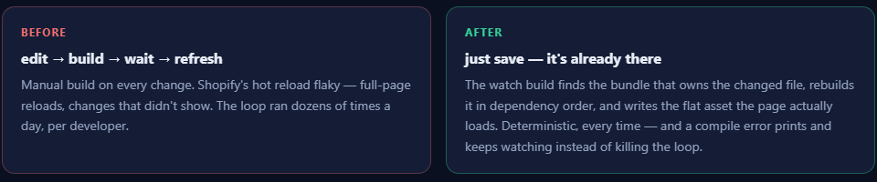
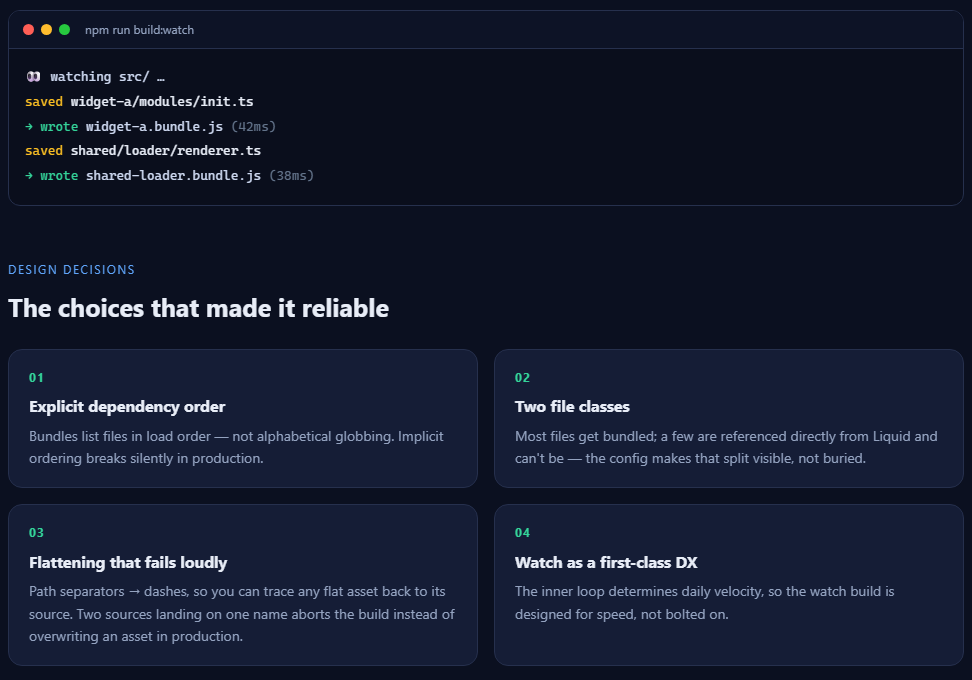

# Shopify Theme-Extension Build Pipeline

**[▶ Open the animated walkthrough](https://me-shahsavan.github.io/shopify-extension-build/)**
&nbsp;·&nbsp; or open `index.html` in a browser.

A case study in fixing a slow developer inner-loop. Shopify's native hot reload
for theme app extensions is unreliable, and the asset folder must be **flat**
(no subdirectories) — together that forced developers into a slow
edit → manual build → wait loop on every change. This pipeline replaces that
with a **watch build** that recompiles a nested, modular source tree into
Shopify's flat assets the instant a file is saved.

> Illustrative reconstruction of a build system I designed and shipped. Product
> names, widget names, and business logic are genericized — this repo shows the
> **pattern and the reasoning**, not proprietary source. Written with AI
> assistance for drafting; the design decisions are mine, and every claim in this
> README is one I verified by running the build in this repo.







---

## The problem: the inner loop was killing team velocity

Two Shopify constraints stacked on top of each other:

**1. Native hot reload for theme app extensions is unreliable.**
Shopify's CLI is supposed to hot-reload extension assets, but in practice it
often does a full-page reload instead — or logs that a file changed without the
change actually showing up. ([Shopify/cli #5488](https://github.com/Shopify/cli/issues/5488))
So developers couldn't trust "save and see it."

**2. The `assets/` folder must be flat.**
Every file has to sit at the top level — no subdirectories. Assets are referenced
by flat filename via the block's `javascript`/`stylesheet` schema or `asset_url`,
so a nested layout simply doesn't work.

Put together, the daily reality was:

```
edit a file  →  run a manual build  →  wait  →  refresh  →  maybe see it
                ▲ every single change, every developer
```

For a widget platform that's thousands of lines across many modules, that loop
ran dozens of times a day per developer. It was the single biggest drag on how
fast the team could ship.

## The solution: a watch build that makes the loop instant

The fix was to stop fighting either constraint and absorb both in one place — a
**watch build** that owns the nested → flat compilation and runs it
automatically on every save.

```
  Developer just saves.                    The watch build, on each save:
  (nested, modular source)                 ─────────────────────────────
  src/                                      1. detect the changed file
    shared/loader/renderer.ts   ──save──►   2. find the bundle that owns it
    widget-a/modules/init.ts                3. recompile that bundle, in order
                                            4. write its flat asset into assets/
                                            ▼
                                       assets/  (flat, ready)
                                         shared-loader.bundle.js
                                         widget-a.bundle.js
```

The unit of rebuild is the **bundle**, not the file. Writing just the changed
file would be faster and useless: the page loads `widget-a.bundle.js`, so that is
what has to be fresh. The few files Liquid references directly are the exception —
those are written under their own flat name.

| | Before | After |
|---|---|---|
| Trigger | manual build, every change | automatic, on save |
| Feedback loop | edit → build → wait → refresh | save → it's already there |
| Reliability | Shopify hot reload flaky / full-page reload | deterministic, every time |
| Source layout | forced flat (unmaintainable) | nested & modular (build flattens it) |

Three commands cover the lifecycle:

| Command | What it does | Who uses it |
|---|---|---|
| `build:watch` | Watches the source tree and rebuilds **only the bundle that owns the changed file** on save | Internal devs (the fast inner loop) |
| `build:bundle` | Concatenates files **in dependency order**, compiles TS→JS, minifies, writes flat `.bundle.js` / `.bundle.css` | CI / release |
| `build:release` | `bundle` + obfuscate for production | Release |

## Key design decisions



**1. Watch is a first-class developer experience, not an afterthought.**
The inner loop determines daily velocity, so the watch build rebuilds the
smallest thing the browser actually loads: the one bundle that owns the file you
just saved. The developer never thinks about flattening, or about which bundle a
module belongs to — they just save. And because a syntax error is the most
common event in a watch loop, a failed compile prints the error and keeps
watching; a watcher that dies on a typo is worse than no watcher, because you
only notice when the next save silently does nothing.

**2. Flattening is a deterministic path transform, and collisions fail the build.**
A nested path becomes a flat filename by replacing separators:
`shared/loader/resource-loader.ts` → `shared-loader-resource-loader.js` — readable,
so you can always trace an asset back to its source. That mapping is not injective
on its own (`widget-a/init.ts` and `widget-a-init.ts` would collide), so rather than
encode around it, both builds assert uniqueness before writing anything. A name
clash is a five-second rename at build time and a silently overwritten asset in
production.

**3. Order is explicit, not globbed.**
Some modules must load before others (a shared loader before the widgets that use
it). Bundle definitions list files in explicit dependency order — implicit
ordering is exactly what breaks silently in production.

**4. Two file classes, handled differently.**
Most files get bundled. A few are referenced directly from Liquid templates and
can't be — they're copied and compiled individually. The config makes that split
visible rather than buried.

**5. Bundled modules are self-executing and global-scoped, not ES modules.**
A bundle is a concatenation, and concatenation only works if the pieces don't
`import` each other — otherwise the emitted `import` statements survive into a
file the storefront can't parse. So bundled modules are IIFEs that attach to one
global namespace (`window.WidgetPlatform`), and the ordering in the bundle map is
the dependency graph, stated by hand. That is the trade: an explicit list a human
maintains, instead of a module graph a bundler resolves. For a handful of widgets
loaded by a Liquid block it's the simpler half of the trade — and the constraint
is written down here rather than discovered later by whoever adds an `import`.

**6. One definition of the bundle map, shared by dev and CI.**
The watch build and the release build import the same `build-core.ts`. Two copies
of the file list would drift, and the drift would surface in production — where
the flat filenames are the only thing Liquid knows about.

## Why this is a product decision, not just a build script

The constraints are Shopify's, but the **cost** lands on developers — and a slow,
unreliable inner loop quietly taxes every feature shipped afterward. The pipeline
is where that cost gets paid **once, centrally**, instead of by every developer on
every change. The trade I chose: add one build step to maintain, to buy an inner
loop that's fast and trustworthy. For a growing widget platform, that compounds
on every change the team makes.

## Run it

```bash
npm install
npm run build:bundle    # writes the flat assets, minified (the CI path)
npm run build:watch     # then edit anything under src/ and watch it rebuild
npm run typecheck
```

What the watch build prints, captured from this repo: a save, a typo, and the fix.

```text
👀 watching src/ … (Ctrl+C to stop)
👀 widget-a/modules/init.ts  →  widget-a.bundle.js, widget-a.bundle.css  (66ms)
❌ widget-a/modules/init.ts
Transform failed with 1 error:
<stdin>:7:15: ERROR: Unexpected ";"
👀 widget-a/modules/init.ts  →  widget-a.bundle.js, widget-a.bundle.css  (9ms)
```

`src/` is a small stand-in widget platform — enough real modules to exercise
dependency order, both file classes, and the flatten transform. Save
`src/widget-a/modules/init.ts` and the watch build rewrites
`widget-a.bundle.js`; introduce a syntax error and it prints the esbuild error
and keeps watching.

## What's in this repo

```
README.md
index.html                     # animated walkthrough (open in a browser)
examples/
  build-core.ts                # bundle map + flatten transform + compile/write
  watch.example.ts             # the watch build — the core of the story
  bundle.config.example.ts     # the release build (minified, all bundles)
  source-tree.md               # nested source → flat output
src/                           # illustrative source tree the builds run against
```

The example source is intentionally small and neutral — it demonstrates the watch
loop, the flattening transform, and explicit-order bundling, without any
proprietary code.
